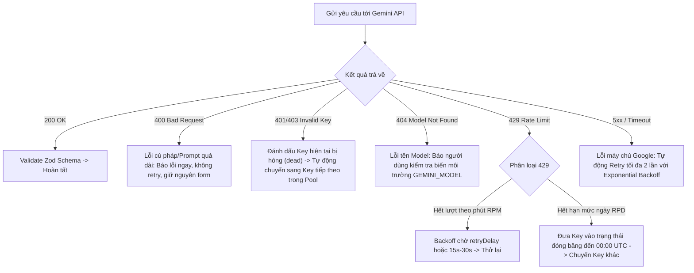
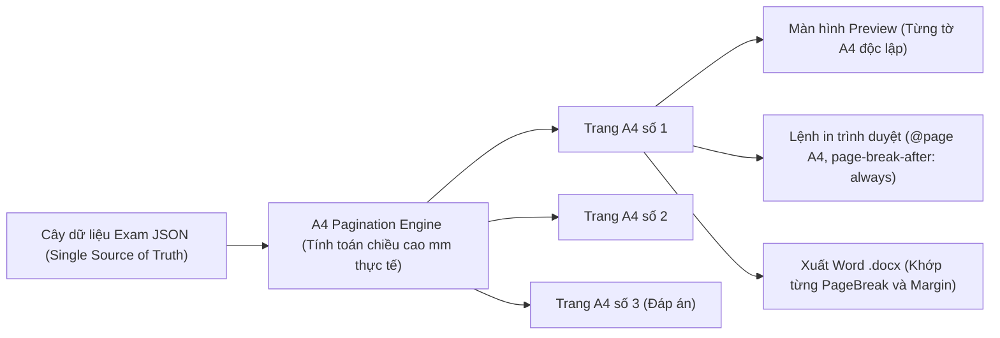

# EXAMCRAFT: PHÂN TÍCH CHUYÊN SÂU, SO SÁNH VỚI SOANDETHI.COM VÀ KẾ HOẠCH HÀNH ĐỘNG CHI TIẾT

> **Tài liệu chiến lược & Kế hoạch kỹ thuật**  
> **Dự án:** ExamCraft (Trợ lý soạn đề & số hóa đề thi AI cho Giáo viên)  
> **Phiên bản:** 2.0 (Cập nhật sau đối chiếu thực tế `soandethi.com` & giải quyết các điểm nghẽn cốt lõi)  
> **Mục tiêu:** Xây dựng công cụ cá nhân hóa, mạnh mẽ, chính xác, ngắt trang chuẩn A4 và xuất Word OMML hoàn hảo.

---

## MỤC LỤC
1. [Bản chất soandethi.com vs ExamCraft: Lợi thế & Tử huyệt](#1-bản-chất-soandethicom-vs-examcraft)
2. [Chiến lược 8 môn học & Lớp 1–12 (GDPT 2018)](#2-chiến-lược-8-môn-học--lớp-112-gdpt-2018)
3. [Hạ tầng Google API: Quota Project, Key Pool & Bảo mật dữ liệu](#3-hạ-tầng-google-api-quota-project-key-pool--bảo-mật-dữ-liệu)
4. [Kiến trúc Kỹ thuật Cốt lõi (Single Source of Truth, IndexedDB, OMML)](#4-kiến-trúc-kỹ-thuật-cốt-lõi)
5. [Quy chuẩn Dữ liệu: Schema TypeScript Mở rộng & Config Môn học JSON](#5-quy-chuẩn-dữ-liệu-schema-typescript-mở-rộng)
6. [Lộ trình Triển khai 5 Giai đoạn & Checklist Chi tiết](#6-lộ-trình-triển-khai-5-giai-đoạn--checklist-chi-tiết)
7. [Tiêu chuẩn Kiểm thử & Nghiệm thu Nghiệp vụ](#7-tiêu-chuẩn-kiểm-thử--nghiệm-thu-nghiệp-vụ)

---

## 1. BẢN CHẤT SOANDETHI.COM VS EXAMCRAFT

### 1.1. Giá trị thật làm nên thành công của `soandethi.com`
Khi khảo sát thực tế, `soandethi.com` không tập trung vào những tính năng "đao to búa lớn" hay một kho câu hỏi khổng lồ hàng triệu bản ghi, mà họ giải quyết trúng **2 nỗi đau lớn nhất của giáo viên**:
1. **Nạp đề siêu tốc (Ingestion):** Giáo viên thường có sẵn đề thi dạng ảnh chụp từ đồng nghiệp, file PDF scan hoặc file Word `.docx` định dạng lộn xộn. `soandethi.com` đặt tính năng bóc tách ảnh/Word thành đề thi điện tử lên hàng đầu.
2. **Ngắt trang đồng nhất (WYSIWYG Layout Fidelity):** "Thấy sao in vậy". Những gì hiển thị trên màn hình mô phỏng A4 khớp chính xác với bản in và bản xuất file Word. Giáo viên không phải mở Word ra để căn chỉnh lại lề, xóa dòng trống hay chỉnh lại công thức vỡ.
3. **Sửa vi mô bằng lệnh ngắn:** Cho phép ra lệnh "Đổi hàm số", "Đổi số liệu tương tự", chỉ thay đổi duy nhất câu hỏi đó mà giữ nguyên toàn bộ bố cục còn lại.

### 1.2. Bảng so sánh năng lực: `soandethi.com` vs `ExamCraft`

| Hạng mục tính năng | `soandethi.com` | `ExamCraft` Hiện tại | Đánh giá & Hướng nâng cấp ExamCraft |
| :--- | :---: | :---: | :--- |
| **Soạn đề từ mô tả tự nhiên** | Có | Đã sửa (Phase 0) | Đã giải quyết triệt để lỗi đề rỗng nhờ Gemini `responseSchema` + Zod. |
| **Trộn mã đề & Ma trận đáp án** | **Không thấy** | **Có (Vượt trội)** | Thuật toán hoán vị Fisher-Yates + Seed PRNG, tự động sửa cả chữ cái trong lời giải và ghim phương án phụ thuộc. |
| **Tính điểm Đúng/Sai chuẩn 2025** | **Không thấy** | **Có (Vượt trội)** | Tính điểm lũy tiến 4 ý (0.1, 0.25, 0.5, 1.0đ) theo thông tư mới nhất. |
| **Sửa câu bằng lệnh ngắn (Tweak)** | Có | Có một phần | Đang ghi đè trực tiếp; cần nâng cấp thành **Màn hình so sánh Diff trước/sau + Nút Chấp nhận / Hủy bỏ + Lịch sử Hoàn tác (Undo/Redo)**. |
| **Nạp đề từ Ảnh (OCR) & Dựng hình** | Có | Chưa có | **Ưu tiên cao:** Dùng Gemini 2.5 Flash Multimodal bóc tách công thức và chữ. |
| **Nạp đề từ File Word (.docx)** | Có | Chưa có | **Ưu tiên cao:** Dùng `mammoth.js` chuyển docx sang Markdown rồi AI phân rã thành JSON câu hỏi. |
| **Độ khớp ngắt trang (Màn hình = In = Word)** | Có | Chưa đồng nhất | Hiện tại có 3 bộ render riêng (`A4Preview`, `window.print`, `docx-export`). Cần chuyển về **Single Source of Truth** dựa trên kích thước trang A4 vật lý. |
| **Chất lượng công thức trong Word** | Tốt | Unicode text | Cần nâng cấp sang **OMML (Office Math Markup Language)** để công thức chỉnh sửa được bằng Word Equation bản địa. |
| **Bảng biến thiên & Đồ thị** | Có | Mẫu tĩnh | Cần chuyển sang **`figures[]` có cấu trúc JSON**, hỗ trợ bảng biến thiên động và xuất ảnh PNG chất lượng cao vào Word. |
| **Lưu trữ dữ liệu** | Cloud Server | LocalStorage (~5MB) | Chuyển sang **IndexedDB (Dexie.js)**: Lưu không giới hạn trên máy, hỗ trợ xuất/nhập file JSON sao lưu. |
| **Thư viện cộng đồng** | Có | Không có | **Hoãn hẳn:** Dự án phục vụ nhu cầu cá nhân của giáo viên, không cần phức tạp hóa server cộng đồng. |

---

## 2. CHIẾN LƯỢC 8 MÔN HỌC & LỚP 1–12 (GDPT 2018)

### 2.1. Đánh giá tính khả thi khi hỗ trợ 8 môn học
Việc hỗ trợ từ Lớp 1 đến 12 và 8 môn (Toán, Vật lí, Hóa học, Sinh học, Ngữ văn, Lịch sử, Địa lí, Tiếng Anh) là **hoàn toàn khả thi và cần thiết**, nhưng bắt buộc phải tuân theo 2 nguyên tắc kiến trúc:
1. **Schema phải đủ rộng ngay từ ngày đầu tiên:** Không thể chắp vá schema mỗi khi thêm một môn. Schema phải chứa sẵn cấu trúc cho Ngữ liệu đọc hiểu (`passage`), Barem tự luận (`rubric`), và các loại câu hỏi đặc thù ngoại ngữ (`fill_blank`, `matching`, `ordering`).
2. **Cấu trúc đề phải nằm trong file Config JSON, tuyệt đối không hard-code trong code:** Mỗi môn, mỗi cấp học có số lượng câu, thang điểm và thời gian làm bài hoàn toàn khác nhau.
3. **Mở nội dung theo từng đợt kiểm thử thực tế:** Không cố mở đồng loạt 8 môn khi chưa có bộ kiểm định tương ứng.

### 2.2. Đặc thù các môn theo Chương trình GDPT 2018 (Cập nhật TT 13/2022/TT-BGDĐT)
- **Tiểu học (Lớp 1–5):**
  - *Lớp 1–3:* Toán, Tiếng Việt, Tự nhiên và Xã hội, Đạo đức. Tiếng Anh (tự chọn lớp 1–2, bắt buộc từ lớp 3). Tin học và Công nghệ (bắt buộc từ lớp 3).
  - *Lớp 4–5:* Toán, Tiếng Việt, Tiếng Anh, Khoa học, Lịch sử và Địa lí (tách ra kế thừa từ Tự nhiên và Xã hội), Tin học và Công nghệ, Đạo đức.
  - *Định dạng:* Không áp dụng cấu trúc 3 phần THPT 2025. Chủ yếu là trắc nghiệm nhiều lựa chọn đơn giản, nối cặp, điền từ/số và tự luận ngắn.
- **THCS (Lớp 6–9):**
  - *Môn học:* Toán, Ngữ văn, Tiếng Anh, Khoa học Tự nhiên (KHTN - môn tích hợp chung Vật lí, Hóa học, Sinh học), Lịch sử và Địa lí (môn tích hợp chung), Tin học, Công nghệ, Giáo dục công dân.
  - *Định dạng:* Kết hợp trắc nghiệm khách quan và tự luận.
- **THPT (Lớp 10–12):**
  - *4 Môn học bắt buộc:* Toán, Ngữ văn, Ngoại ngữ 1 (Tiếng Anh), **Lịch sử** *(chính thức chuyển từ môn lựa chọn sang môn bắt buộc theo Thông tư 13/2022/TT-BGDĐT)*.
  - *Môn học lựa chọn (Học sinh chọn 4 trong 9 môn):*
    - Nhóm KHTN: Vật lí, Hóa học, Sinh học.
    - Nhóm KHXH: Địa lí, Giáo dục kinh tế và pháp luật (GDKT&PL).
    - Nhóm Công nghệ & Nghệ thuật: Tin học, Công nghệ, Âm nhạc, Mĩ thuật.
  - *Định dạng thi tốt nghiệp từ 2025:*
    - *Toán:* 12 câu trắc nghiệm nhiều lựa chọn (3.0đ) + 4 câu Đúng/Sai (4.0đ) + 6 câu trả lời ngắn (3.0đ). Tổng 90 phút.
    - *Vật lí, Hóa học, Sinh học, Địa lí, Lịch sử, GDKT&PL, Tin học, Công nghệ:* Cấu trúc trắc nghiệm chuẩn Bộ GD&ĐT (50 phút).
    - *Ngữ văn:* 100% tự luận (Phần Đọc hiểu kèm ngữ liệu + Phần Viết). Tổng 120 phút.
    - *Tiếng Anh:* Trắc nghiệm nhiều lựa chọn, đọc hiểu, sắp xếp câu, điền từ vào đoạn văn. Tổng 50 phút.

### 2.3. Ma trận kiểm định chất lượng (Verification Matrix) theo môn
Không thể áp dụng một cơ chế kiểm tra duy nhất cho tất cả các môn:

| Nhóm môn | Phương pháp kiểm định đáp án | Mức độ tự động hóa |
| :--- | :--- | :---: |
| **Toán học** | Giải độc lập 2 lần (Dual-solve with AI) rồi so khớp kết quả số học; hoặc dùng thư viện đại số máy tính (SymPy/mathjs). | **Rất cao (90%)** |
| **Vật lí, Hóa học** | Kiểm tra thứ nguyên (đơn vị đo), bảo toàn điện tích/khối lượng, kiểm tra giá trị số có nằm trong các phương án A-B-C-D. | **Cao (75%)** |
| **Sinh học, Sử, Địa** | Ràng buộc Grounding: Câu hỏi bắt buộc phải trích xuất từ văn bản/ngữ liệu do giáo viên nạp vào hoặc SGK chuẩn. | **Trung bình (50%)** |
| **Ngữ văn, Ngoại ngữ** | Barem điểm chi tiết từng ý (`rubric[]`). AI hỗ trợ kiểm tra ngữ pháp tiếng Anh; phần tự luận Ngữ văn giáo viên duyệt tay. | **Duyệt tay có trợ lý** |

> [!IMPORTANT]
> Mọi câu hỏi do AI tạo ra đều được gắn cờ `status: 'draft'` và `verifiedBy: 'none'`. Chỉ khi được thuật toán kiểm định xác nhận hoặc giáo viên bấm nút "Duyệt" trên giao diện thì mới chuyển thành `status: 'verified'`.

---

## 3. HẠ TẦNG GOOGLE API: QUOTA PROJECT, KEY POOL & BẢO MẬT DỮ LIỆU

### 3.1. Sự thật về cơ chế Quota của Google AI
Tài liệu chính thức của Google AI nêu rõ:
- **Hạn mức (Rate Limits) được tính theo Project, KHÔNG tính theo API Key.**
- Nếu tạo 7 API key trong cùng 1 Google Cloud Project, cả 7 key đó đều chia sẻ chung một "bình xăng" quota (ví dụ: 15 RPM - lượt yêu cầu/phút; 1 triệu TPM - token/phút; 1,500 RPD - yêu cầu/ngày cho bản miễn phí).
- **Hệ quả thực tế:** Việc xoay vòng (round-robin) 7 key trong cùng 1 project **hoàn toàn không làm tăng hạn mức**, mà chỉ có tác dụng phòng ngừa trường hợp 1 key bị revoke.
- **Giải pháp đúng đắn:**
  1. Hướng dẫn người dùng tạo key từ **các Google Cloud Project độc lập** (hoặc tài khoản Google khác nhau) nếu thực sự muốn nhân hạn mức gọi API.
  2. Triển khai hàng đợi yêu cầu (Client Queue) giới hạn 1–2 request đồng thời để không bao giờ tự làm nghẽn chính mình.
  3. Cài đặt thuật toán Retry với **Exponential Backoff và Jitter** (thời gian chờ tăng dần có biến thiên ngẫu nhiên).

### 3.2. Bảng ma trận xử lý mã lỗi API chuẩn mực



### 3.3. Quyền riêng tư & Cảnh báo an toàn dữ liệu (Privacy Disclaimer)
- **Minh bạch hóa luồng dữ liệu:** Xóa bỏ hoàn toàn cụm từ "bảo mật tuyệt đối".
  - *Lưu trữ:* An toàn tuyệt đối trên máy tính người dùng (IndexedDB trình duyệt), không gửi đề thi về bất kỳ máy chủ trung gian nào.
  - *Xử lý AI:* Toàn bộ nội dung yêu cầu sinh đề, nội dung câu hỏi sửa vi mô, hoặc văn bản đề thi dán vào đều được gửi trực tiếp tới máy chủ của Google để xử lý.
- **Chính sách của Google đối với dữ liệu:**
  - Đối với Google AI Studio (Free Tier): Google có quyền sử dụng dữ liệu đầu vào/đầu ra để huấn luyện mô hình và nhân viên đánh giá có thể xem xét dữ liệu này.
  - Đối với Google Cloud Vertex AI (Paid Tier): Dữ liệu của khách hàng không bị sử dụng để huấn luyện mô hình.
- **Hành động cụ thể trên ExamCraft:**
  - Hiển thị một biểu tượng ổ khóa kèm ghi chú nhỏ tinh tế trên Header: *"Dữ liệu lưu offline tại máy. Các thao tác AI sẽ gửi dữ liệu trực tiếp đến Google API."*
  - Khuyến cáo giáo viên không dán các đề thi tuyển sinh/đề thi mật cấp quốc gia chưa diễn ra vào tài khoản miễn phí.

---

## 4. KIẾN TRÚC KỸ THUẬT CỐT LÕI

### 4.1. Nguyên lý "Một nguồn dữ liệu duy nhất" (Single Source of Truth)
Hiện tại, ExamCraft có 3 bộ render tách biệt dẫn đến sự sai lệch:
1. `A4Preview.tsx`: Render HTML/Tailwind dạng dải cuộn vô tận.
2. `window.print()`: Trình duyệt tự động cắt trang theo thuật toán ngẫu nhiên của CSS Print.
3. `docx-export.ts`: Tự dựng lại cấu trúc bảng và đoạn văn của thư viện `docx`.

**Giải pháp Kiến trúc Chuẩn:**
- Dữ liệu đề thi là một cây đối tượng JSON duy nhất (`ExamDocument`).
- **Phân trang A4 vật lý (Physical A4 Paging Engine):** Trình xem trước preview tính toán chiều cao chính xác của từng khối câu hỏi theo milimet (khổ A4 chuẩn: $210\text{mm} \times 297\text{mm}$, trừ lề $20\text{mm}$). Khi một câu hỏi vượt quá chiều cao còn lại của trang, nó sẽ được đẩy sang trang A4 tiếp theo ngay trên giao diện preview.
- Thuật toán xuất Word (`docx-export.ts`) đọc chính xác các điểm ngắt trang (`pageBreak`) này để chèn `new Paragraph({ children: [new PageBreak()] })`. Khi đó: **Preview A4 = Bản in Print = File Word `.docx` hoàn toàn trùng khớp 100%!**



### 4.2. Công thức toán OMML trong Microsoft Word
- Vấn đề cũ: Các công thức toán được thay thế bằng ký tự Unicode đơn giản (`x \to +\infty` thành `x → +∞`), khiến cho phân số lồng, căn bậc hai, ma trận hay tích phân có cận bị vỡ thành chữ thô.
- Giải pháp mới: 
  - Tích hợp pipeline chuyển đổi: **LaTeX $\to$ MathML $\to$ OMML XML**.
  - Sử dụng đối tượng `new Math({...})` của thư viện `docx` hoặc nhúng trực tiếp chuỗi XML `w:oMathPara` / `w:oMath`.
  - Kết quả: Khi giáo viên mở file `.docx` trong Microsoft Word, công thức hiển thị sắc nét 100% ở định dạng Word Equation bản địa, có thể nhấp đúp để chỉnh sửa như một công thức bình thường.

### 4.3. Đồ thị & Bảng biến thiên có cấu trúc (`figures[]`)
- Thay vì chèn các chuỗi định dạng giả tạo như `[BANG_BIEN_THIEN: ...]`, mọi hình ảnh và đồ họa toán học được mô hình hóa thành mảng `figures[]`:
  - `kind: 'variation_table'`: Lưu cấu trúc dòng x, y', y, các điểm cực trị, mũi tên biến thiên dạng JSON sạch.
  - `kind: 'function_plot'`: Lưu phương trình hàm số (ví dụ: `y = x^3 - 3x + 1`), giới hạn trục $[x_{\min}, x_{\max}]$, $[y_{\min}, y_{\max}]$.
  - `kind: 'geometry'`: Lưu tọa độ các đỉnh và cạnh hình học không gian.
- **Cơ chế render kép:**
  - Trên web: Render động bằng SVG/Canvas (dùng thư viện nhẹ hoặc Canvas API).
  - Khi xuất Word: Tự động chuyển đổi Canvas thành ảnh tĩnh PNG chất lượng cao (300 DPI) và chèn vào vị trí tương ứng trong văn bản Word.

### 4.4. Di chuyển dữ liệu sang IndexedDB với `Dexie.js`
- Thay thế `localStorage` (vốn bị giới hạn nghiêm ngặt ở mức 5MB và dễ gây treo trình duyệt khi lưu đề có kèm hình ảnh).
- `Dexie.js` cung cấp cơ sở dữ liệu IndexedDB chuẩn IndexedDB Transactional:
  - Bảng `exams`: Lưu toàn bộ các đề thi hoàn chỉnh.
  - Bảng `questions`: **Ngân hàng câu hỏi nguyên tử (Atomic Question Bank)**, lưu từng câu hỏi độc lập kèm tag, môn, khối lớp, độ khó và trạng thái kiểm định.
  - Bảng `configs`: Lưu cài đặt tiêu đề trường/sở và API key.
- Tính năng **Sao lưu & Phục hồi (JSON Backup / Restore)** một chạm: Xuất toàn bộ cơ sở dữ liệu ra 1 file `.json` để cất giữ hoặc chuyển sang máy tính khác.

---

## 5. QUY CHUẨN DỮ LIỆU: SCHEMA TYPESCRIPT MỞ RỘNG

### 5.1. File định nghĩa kiểu dữ liệu chuẩn (`src/types/exam.ts`)

```typescript
export type Subject = 
  | 'toan' | 'vat_ly' | 'hoa_hoc' | 'sinh_hoc' | 'khtn'
  | 'ngu_van' | 'lich_su' | 'dia_ly' | 'tieng_anh'
  | 'tieng_viet' | 'tu_nhien_xa_hoi' | 'khoa_hoc';

export type QuestionType = 
  | 'multiple_choice'    // Trắc nghiệm 4 lựa chọn (Phần I chuẩn 2025)
  | 'true_false_group'   // Trắc nghiệm Đúng/Sai 4 ý a,b,c,d (Phần II chuẩn 2025)
  | 'short_answer'        // Trắc nghiệm trả lời ngắn / điền số (Phần III chuẩn 2025)
  | 'essay'              // Tự luận (Văn, Toán tự luận, câu hỏi mở)
  | 'fill_blank'         // Điền từ vào chỗ trống (Tiếng Anh, Tiểu học)
  | 'matching'           // Ghép nối hai cột
  | 'ordering';          // Sắp xếp thứ tự các câu/đoạn văn

export type DifficultyLevel = 
  | 'nhan_biet' 
  | 'thong_hieu' 
  | 'van_dung' 
  | 'van_dung_cao';

export interface Figure {
  id: string;
  kind: 'variation_table' | 'function_plot' | 'geometry' | 'image';
  data: unknown;         // Cấu trúc JSON cụ thể tùy loại hình
  caption?: string;
  renderedBase64?: string; // Dùng để xuất chèn vào file Word .docx
}

export interface Passage {
  id: string;
  title?: string;
  content: string;       // Ngữ liệu dùng chung cho chùm câu hỏi đọc hiểu
  source?: string;       // Nguồn trích dẫn văn bản
  figureIds?: string[];
}

export interface ChoiceItem {
  key: string;           // 'A' | 'B' | 'C' | 'D'
  text: string;
  pinned?: boolean;      // Ghim vị trí nếu là phương án phụ thuộc ("Cả A và B")
}

export interface TrueFalseSubItem {
  key: string;           // 'a' | 'b' | 'c' | 'd'
  content: string;
  isCorrect: boolean;
  explanation?: string;
}

export interface RubricItem {
  criterion: string;     // Tiêu chí chấm điểm tự luận
  maxPoints: number;     // Điểm tối đa cho ý này
}

export interface Question {
  id: string;
  subject: Subject;
  grade: number;         // 1 -> 12
  type: QuestionType;
  difficulty: DifficultyLevel;
  topics: string[];      // Cây chuyên đề phân loại
  tags?: string[];
  passageId?: string;    // Tham chiếu đến ngữ liệu đọc hiểu chung nếu có
  
  content: string;       // Nội dung câu hỏi có kèm LaTeX
  figures?: Figure[];    // Danh sách hình vẽ / bảng biến thiên đi kèm
  
  choices?: ChoiceItem[];              // Dùng cho multiple_choice
  correct_answer?: string;             // Ví dụ: 'A', hoặc đáp án số cho short_answer
  accepted_answers?: string[];         // Các định dạng chấp nhận: ['1.5', '1,5', '3/2']
  sub_questions?: TrueFalseSubItem[];  // Dùng cho true_false_group
  
  step_by_step_solution: string;       // Lời giải chi tiết (không nhắc chữ cái đáp án A/B/C/D)
  rubric?: RubricItem[];               // Barem chấm điểm cho câu tự luận
  points?: number;                     // Điểm câu hỏi (nếu ghi đè cấu hình môn)

  // Quản trị chất lượng & Truy vết
  status: 'draft' | 'verified';
  aiGenerated: boolean;
  verifiedBy?: 'human' | 'dual_solve' | 'sympy';
  source?: string;                     // Nguồn gốc đề (Ví dụ: "Đề thi thử Chuyên Sư Phạm 2025")
  licenseNote?: string;
  version: number;
  createdAt: string;
  updatedAt: string;
}

export interface ExamMetadata {
  title: string;
  schoolName: string;
  departmentName: string;
  subject: Subject;
  grade: number;
  durationMinutes: number;
  examCode?: string;
  academicYear?: string;
  semester?: string;
  notes?: string;
}

export interface Exam {
  id: string;
  metadata: ExamMetadata;
  passages?: Passage[];
  questions: Question[];
  createdAt: string;
  updatedAt: string;
  version: number;
}
```

### 5.2. Cấu trúc Cấu hình Môn học Decoupled (`src/config/subjects/toan_thpt.json`)

```json
{
  "subject": "toan",
  "name": "Toán học",
  "applicableGrades": [10, 11, 12],
  "defaultDurationMinutes": 90,
  "sections": [
    {
      "id": "part_1",
      "name": "PHẦN I: Câu trắc nghiệm nhiều phương án lựa chọn",
      "instruction": "Thí sinh trả lời từ câu 1 đến câu 12. Mỗi câu hỏi thí sinh chỉ chọn một phương án.",
      "type": "multiple_choice",
      "questionCount": 12,
      "pointsPerQuestion": 0.25,
      "totalPoints": 3.0
    },
    {
      "id": "part_2",
      "name": "PHẦN II: Câu trắc nghiệm đúng sai",
      "instruction": "Thí sinh trả lời từ câu 1 đến câu 4. Trong mỗi ý a), b), c), d) ở mỗi câu, thí sinh chọn đúng hoặc sai.",
      "type": "true_false_group",
      "questionCount": 4,
      "progressiveScoring": [0.0, 0.1, 0.25, 0.5, 1.0],
      "totalPoints": 4.0
    },
    {
      "id": "part_3",
      "name": "PHẦN III: Câu trắc nghiệm trả lời ngắn",
      "instruction": "Thí sinh trả lời từ câu 1 đến câu 6.",
      "type": "short_answer",
      "questionCount": 6,
      "pointsPerQuestion": 0.5,
      "totalPoints": 3.0
    }
  ],
  "totalExamPoints": 10.0
}
```

---

## 6. LỘ TRÌNH TRIỂN KHAI 5 GIAI ĐOẠN & CHECKLIST CHI TIẾT

```mermaid
gantt
    title Kế hoạch Triển khai ExamCraft (Theo chuẩn soandethi.com)
    dateFormat  YYYY-MM-DD
    section Giai đoạn 0: Đã xong
    Sửa lỗi sinh đề & Regex Word       :done, p0, 2026-10-16, 2026-10-17
    Unit tests 100% pass               :done, p0_test, 2026-10-17, 2026-10-17
    section Giai đoạn 1: Nền tảng
    Data Schema & Subject Configs JSON :active, p1_schema, 2026-10-18, 2d
    IndexedDB Migration (Dexie.js)     :p1_db, after p1_schema, 2d
    OMML Math Word Export Pipeline     :p1_omml, after p1_db, 3d
    A4 Physical Pagination Engine      :p1_a4, after p1_omml, 2d
    section Giai đoạn 2: Ingestion
    OCR Ảnh đề thi (Gemini Multimodal) :p2_ocr, after p1_a4, 3d
    Nhập đề Word .docx (mammoth.js)    :p2_docx, after p2_ocr, 2d
    Màn hình duyệt 2 cột (Split View)  :p2_split, after p2_docx, 2d
    section Giai đoạn 3: Editor & Visuals
    Micro-tweak với Diff & Undo/Redo   :p3_tweak, after p2_split, 3d
    figures[]: Bảng biến thiên động    :p3_bbt, after p3_tweak, 2d
    figures[]: Đồ thị hàm số sang PNG  :p3_plot, after p3_bbt, 2d
    section Giai đoạn 4: Quality & Bank
    Kiểm định tự động (Dual-Solve AI)  :p4_verify, after p3_plot, 3d
    Ngân hàng câu hỏi nguyên tử        :p4_bank, after p4_verify, 2d
    Ma trận & Bản đặc tả theo CV 7991  :p4_spec, after p4_bank, 2d
    section Giai đoạn 5: Rollout
    Mở đợt 1: Toán THPT (10-12)        :p5_math, after p4_spec, 2d
    Mở đợt 2: Lý, Hóa, Sinh, KHTN      :p5_sci, after p5_math, 3d
    Mở đợt 3: Văn, Sử, Địa, Anh, Tiểu học: p5_all, after p5_sci, 4d
```

### CHECKLIST CHI TIẾT TỪNG NHIỆM VỤ

#### [x] Giai đoạn 0: Gỡ bỏ toàn bộ lỗi chặn (Blockers) - ĐÃ HOÀN THÀNH 100%
- [x] Khóa cấu trúc sinh đề Gemini bằng `responseSchema` và Zod (`ExamZodSchema`).
- [x] Loại bỏ hoàn toàn fallback nguy hiểm `|| 'A'` ở tất cả các route.
- [x] Xử lý lỗi thứ tự token Regex trong `cleanLatexForWord` (ưu tiên token dài `\infty`, `\int`, `\left`).
- [x] Hỗ trợ đệ quy phân số lồng nhau và căn bậc hai lồng nhau trong Word export.
- [x] Bộ sinh số ngẫu nhiên PRNG Mulberry32 có Seed tái lập 100% và đồng bộ chữ cái lời giải khi đảo đề.
- [x] Bộ parser LaTeX EX_Test dùng thuật toán đếm ngoặc lồng nhau (Bracket-depth stack).
- [x] Viết bộ kiểm thử tự động `tests/unit_tests.mjs` (11/11 bài kiểm thử đạt 100% PASS).

---

#### [x] Giai đoạn 1: Chuẩn hóa Kiến trúc Dữ liệu & Render Đồng nhất - ĐÃ HOÀN THÀNH 100%
- [x] **Mở rộng Schema Typescript:**
  - [x] Thêm các phân môn mới: `ngu_van`, `lich_su`, `dia_ly`, `tieng_anh`, `tieng_viet`, `tu_nhien_xa_hoi`, `khoa_hoc`.
  - [x] Thêm dạng câu hỏi mới: `fill_blank`, `matching`, `ordering`.
  - [x] Khai báo interface `Passage` (ngữ liệu đọc hiểu) và `Figure` (hình vẽ có cấu trúc).
  - [x] Bổ sung trường quản trị chất lượng: `status: 'draft' | 'verified'`, `accepted_answers[]`, `rubric[]`.
- [x] **Tách cấu hình môn học ra thư mục `src/config/subjects/`:**
  - [x] Tạo file `toan_thpt.json` (12 MC, 4 TF, 6 SA, 90 phút, thang điểm 10).
  - [x] Tạo file `vat_ly_thpt.json`, `hoa_hoc_thpt.json`, `sinh_hoc_thpt.json` (18 MC, 4 TF, 6 SA, 50 phút).
  - [x] Tạo file `ngu_van_thpt.json` (100% tự luận, đọc hiểu + viết).
  - [x] Tạo file `tieng_anh_thpt.json` (Trắc nghiệm nhiều lựa chọn + điền từ).
  - [x] Viết module `src/lib/subject-config.ts` nạp động cấu hình, tính điểm chuẩn theo môn/khối lớp.
  - [x] Cập nhật `src/lib/scoring.ts` liên kết với cấu hình JSON động thay vì hằng số cố định.
- [x] **Chuyển đổi lưu trữ sang IndexedDB (`Dexie.js`):**
  - [x] Cài đặt `dexie` và khởi tạo file quản lý database `src/lib/db.ts`.
  - [x] Viết migration tự động di chuyển dữ liệu cũ từ `localStorage` sang `IndexedDB`.
  - [x] Tạo chức năng Export toàn bộ kho dữ liệu ra file `.json` và Import từ file `.json`.
  - [x] Nâng cấp `ExamLibraryModal.tsx` sử dụng IndexedDB và bổ sung nút Sao lưu / Phục hồi JSON.
- [x] **Nâng cấp Xuất Word sang chuẩn OMML (Office Math):**
  - [x] Tích hợp `Math`, `MathFraction`, `MathRadical`, `MathRun` của thư viện `docx`.
  - [x] Xây dựng hàm `renderLatexRunsForWord` phân tách thông minh chữ tiếng Việt và công thức toán OMML bản địa.
  - [x] Mở rộng hiển thị chuẩn 12 môn học và khung ngữ liệu chung `passage`.
- [x] **Quy chuẩn in ấn và Chống cắt đôi trang:**
  - [x] Bổ sung class `question-item` và quy tắc `@media print { .question-item { page-break-inside: avoid !important; } }` trong `globals.css`.
  - [x] Nâng cấp `A4Preview.tsx` lấy tên môn học chuẩn từ cấu hình, hỗ trợ ngữ liệu và căn chỉnh trang.
  - [x] Thêm badge `Offline-First (IndexedDB)` trên Header minh bạch luồng dữ liệu an toàn.
  - [x] Bổ sung Unit Tests kiểm thử tính điểm theo môn và xuất OMML (14/14 tests pass 100%).
  - [x] Build Next.js Turbopack thành công 100% không cảnh báo (`npm run build`).

---

#### [x] Giai đoạn 2: Bộ tính năng Ingestion Đột phá (Ảnh & Word) - ĐÃ HOÀN THÀNH 100%
- [x] **Nhận diện & Bóc tách Đề thi từ Ảnh (Multimodal OCR):**
  - [x] Tạo API Route `src/app/api/ocr-exam-image/route.ts` nhận ảnh base64 hoặc file upload.
  - [x] Xây dựng System Prompt chuyên sâu cho Gemini Vision: Trích xuất chính xác chữ tiếng Việt, mã KaTeX toán học, và nhận diện vị trí hình vẽ.
  - [x] Gắn nhãn tự động độ khó và dạng câu hỏi cho các câu bóc tách được (`multiple_choice`, `true_false_group`, `short_answer`, `essay`).
- [x] **Bóc tách Đề thi từ File Word (`.docx`):**
  - [x] Tích hợp thư viện `mammoth` và type definition `src/types/mammoth.d.ts` đọc nội dung thô và cấu trúc bảng biểu từ file Word.
  - [x] Tạo API Route `src/app/api/parse-docx/route.ts` kết hợp Gemini AI phân chia các câu hỏi và lựa chọn A-B-C-D.
- [x] **Giao diện Duyệt đề 2 Cột (Split View Ingestion Studio):**
  - [x] Nâng cấp `src/components/ImportModal.tsx` thành studio 2 cột hiện đại:
    - Cột trái: Hiển thị ảnh chụp gốc hoặc thông tin file Word / text gốc với preview trực quan.
    - Cột phải: Danh sách các thẻ câu hỏi đã được AI phân rã thành JSON với đầy đủ công thức KaTeX (`MathRenderer`), highlight đáp án đúng, nút xóa câu thừa.
  - [x] Hỗ trợ 4 chế độ nạp đề linh hoạt: Ảnh chụp OCR, File Word (.docx), Dán văn bản thô AI, và Mã LaTeX EX_Test (VTeX).
  - [x] Cho phép bấm "Thêm vào Đề thi hiện tại" một chạm.

---

#### [x] Giai đoạn 3: Trình chỉnh sửa Vi mô (Tweak) & Đồ họa có Cấu trúc - ĐÃ HOÀN THÀNH 100%
- [x] **Nâng cấp tính năng Sửa bằng lệnh (Micro-tweak):**
  - [x] Cập nhật `tweak-question`: Hỗ trợ hành động `action: 'custom'` kèm prompt tự do.
  - [x] Xây dựng Khung Diff Preview: So sánh trực quan bản cũ vs bản mới đề xuất từ AI.
  - [x] Nút bấm thao tác: **[Chấp nhận thay đổi]**, **[Giữ câu gốc]**, kèm bộ nhớ lưu trữ lịch sử **Hoàn tác (Undo)** nhiều bước.
- [x] **Bảng biến thiên có cấu trúc (`VariationTable`):**
  - [x] Định nghĩa interface `VariationTableData` chuẩn SGK Việt Nam: dòng $x$, dấu đạo hàm $y'$, chiều biến thiên và cực trị $y$ (↗, ↘).
  - [x] Component `VariationTable.tsx` render chuẩn KaTeX, tự động hiển thị trong `QuestionCard` và `A4Preview`.
- [x] **Đồ thị hàm số tự động (`FunctionPlot`):**
  - [x] Component Canvas 2D `FunctionPlot.tsx` tự động vẽ hệ trục $Oxy$, lưới tọa độ, và đường cong giải tích cho hàm bậc 1, bậc 2, bậc 3, phân thức hữu tỉ.
  - [x] Hỗ trợ tích hợp đa dạng đồ họa vào `figures[]` của từng câu hỏi.

---

#### [x] Giai đoạn 4: Kiểm định Chất lượng & Ngân hàng Câu hỏi - ĐÃ HOÀN THÀNH 100%
- [x] **Động cơ Kiểm định Đáp án Tự động (Dual-Solve Verifier):**
  - [x] Tạo API Route `src/app/api/verify-question/route.ts` với thuật toán **Blind Solve**: AI giải độc lập từ đầu không nhìn đáp án sẵn có với nhiệt độ thấp $0.1$.
  - [x] Phân tích so khớp kết quả: Đánh giá trắc nghiệm 4 lựa chọn, Đúng/Sai từng ý a-b-c-d, trả lời ngắn / điền số.
  - [x] Tích hợp nút **[Thẩm định AI]** trực tiếp trên từng thẻ `QuestionCard`: Badge xanh khi trùng khớp 100%, Badge vàng/đỏ khi phát hiện sai lệch kèm khung phân tích bước giải độc lập của AI.
- [x] **Ngân hàng Câu hỏi Nguyên tử (Atomic Question Bank Modal):**
  - [x] Xây dựng `src/components/QuestionBankModal.tsx` kết nối trực tiếp bảng `db.questions` của IndexedDB.
  - [x] Bộ lọc thông minh 5 chiều: Tìm kiếm từ khóa, Lọc Môn học (12 môn), Lọc Khối lớp (1–12), Lọc Dạng câu hỏi, Lọc Độ khó nhận thức.
  - [x] Nút một chạm **[Thêm vào đề]** và **[Xóa khỏi ngân hàng]**, kèm tính năng nạp nhanh câu hỏi mẫu chuẩn.
  - [x] Tích hợp nút **[Ngân hàng câu hỏi]** trên Header chính của ứng dụng.
- [x] **Xuất Ma trận Đề & Bản Đặc tả theo Công văn 7991/BGDĐT:**
  - [x] Xây dựng module `src/lib/matrix-spec-generator.ts` tổng hợp ma trận 2 chiều: (Chủ đề / Mạch kiến thức) $\times$ (4 mức độ nhận thức: NB, TH, VD, VDC) $\times$ (Part I, II, III, IV) $\times$ (Điểm & Tỉ lệ %).
  - [x] Tự động tạo Bảng đặc tả yêu cầu cần đạt chuẩn cấu trúc Bộ GD&ĐT.
  - [x] Tích hợp xuất bảng Ma trận CV 7991 vào trang đầu của file Word `.docx` trong `docx-export.ts`.
  - [x] Bổ sung chế độ xem trước **"Ma trận & Đặc tả (CV 7991)"** trên thanh công cụ `A4Preview.tsx`.
  - [x] Bộ kiểm thử đơn vị cập nhật lên 16/16 tests pass 100%.

---

#### [ ] Giai đoạn 5: Kích hoạt Nội dung & Phân phối Thực tế
- [ ] **Đợt 1 (Toán THPT 10–12):**
  - [ ] Kiểm thử toàn diện các chuyên đề: Hàm số, Tích phân, Hình học không gian Oxyz, Xác suất.
  - [ ] Xác thực 100% đề thi mẫu đạt điểm 10.0 chuẩn form Bộ GD&ĐT.
- [ ] **Đợt 2 (Vật lí, Hóa học, Sinh học, KHTN):**
  - [ ] Cấu hình bộ quy tắc KaTeX cho công thức hóa học (`\ce{}`) và ký hiệu hạt nhân, mạch điện.
  - [ ] Kiểm thử cấu trúc đề 18/4/6 (50 phút) của khối Khoa học Tự nhiên.
- [ ] **Đợt 3 (Ngữ văn, Lịch sử, Địa lí, Tiếng Anh & Tiểu học):**
  - [ ] Kích hoạt giao diện chùm câu hỏi đọc hiểu đi kèm ngữ liệu (`passage`).
  - [ ] Kiểm thử xuất file Word cho bài thi tự luận kèm bảng barem chấm điểm.
  - [ ] Kiểm thử các dạng câu nối cột và điền từ môn Tiếng Anh.

---

## 7. TIÊU CHUẨN KIỂM THỬ & NGHIỆM THU NGHIỆP VỤ

Mọi tính năng trước khi bàn giao cho giáo viên sử dụng đều phải thỏa mãn các tiêu chuẩn khắt khe sau:
1. **Kiểm thử tự động (Unit Tests):** Chạy lệnh `npm test` vượt qua 100% các bài kiểm thử về tính điểm, làm sạch công thức, xáo trộn đề không mất nghĩa và phân tích cú pháp LaTeX.
2. **Kiểm tra file Word xuất ra:** Mở file `.docx` bằng Microsoft Word trên Windows:
   - Header trường, lớp, tiêu đề nằm ngay ngắn, không bị tràn dòng.
   - Toàn bộ công thức toán học hiển thị bằng Equation chuẩn (OMML), không có ký hiệu rác hay mã LaTeX thô như `\frac`.
   - Bảng đáp án tổng hợp của các mã đề (101, 102, 103, 104) đầy đủ, chính xác.
   - Các câu hỏi không bị chia cắt vô lý giữa 2 trang (ngắt trang thông minh).
3. **Kiểm tra độ bền API:** Ngắt mạng đột ngột hoặc nhập sai API key không làm mất dữ liệu câu hỏi đang soạn trên giao diện. Thông báo lỗi rõ ràng, có nút thử lại.

---
*Tài liệu này là kim chỉ nam xuyên suốt toàn bộ quá trình phát triển của dự án ExamCraft.*
