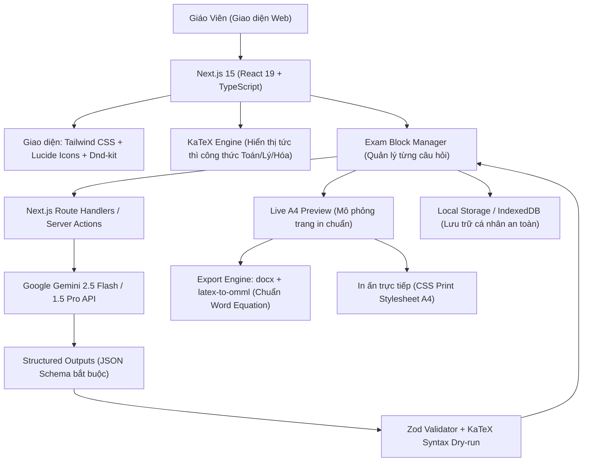
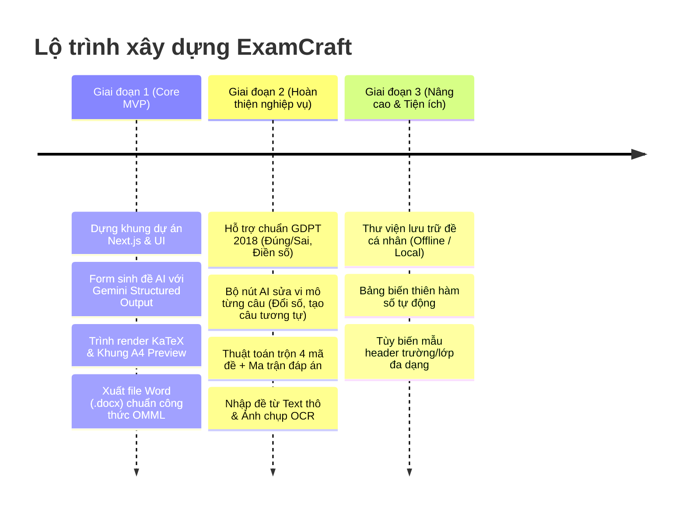

# BẢN PHÂN TÍCH TOÀN DIỆN & LỘ TRÌNH DỰ ÁN "EXAMCRAFT - WEB SOẠN ĐỀ AI"
*Dựa trên việc giải mã và phân tích chuyên sâu tài liệu `Xây Dựng Web Soạn Đề AI.docx`*

---

## 1. ĐÁNH GIÁ TÍNH HỢP LÝ CỦA FILE TÀI LIỆU (DOCX)

Tài liệu gốc ghi lại cuộc thảo luận chuyên sâu về việc tái hiện và nâng cấp mô hình trợ lý soạn đề tương tự `soandethi.com` phục vụ nhu cầu cá nhân của một giáo viên (Toán, KHTN/Lý, Hóa từ lớp 1 đến 12). 

### 1.1. Những điểm cực kỳ hợp lý và đúng đắn (Core Strengths)
1. **Tư duy "Câu hỏi nguyên tử" (Atomic Structured Question):**
   - Tài liệu đã chỉ ra đúng tử huyệt của việc làm phần mềm thi cử: *Không được lưu cả đề thi như một văn bản dài (Word/HTML thuần)*.
   - Bắt buộc phải lưu dưới dạng một danh sách các Object câu hỏi JSON độc lập. Chỉ khi có cấu trúc này, ta mới có thể:
     - Trộn đề tự động (đảo câu, đảo đáp án A-B-C-D).
     - Ra lệnh cho AI sửa vi mô (in-place micro-prompting): Đổi số liệu câu 3, tăng độ khó câu 5 mà không làm xáo trộn các câu khác.
     - Bóc tách barem điểm và lời giải chi tiết.
2. **Quyết định chuyển hướng từ "Data-centric" sang "AI-centric":**
   - Việc cố gắng xây dựng một database tĩnh đồ sộ chứa hàng chục nghìn câu hỏi cho 12 khối lớp cho 1 người phát triển là **bẫy tử thần** (dễ nản, mất hàng tháng chỉ để cào dữ liệu, sửa lỗi LaTeX và bảo trì database).
   - Chuyển sang mô hình **AI-centric** (AI trực tiếp sinh đề theo ma trận yêu cầu + AI OCR bóc tách đề có sẵn) là chiến lược thực chiến tối ưu nhất cho dự án cá nhân.
3. **Chiến lược kiểm soát ảo giác AI 4 lớp (AI Guardrails):**
   - Tài liệu đã nhận diện đúng rủi ro lớn nhất của LLM: Tính ngẫu nhiên (non-deterministic), hay "nói nhảm", sai cú pháp LaTeX và đoán mò đáp án.
   - Giải pháp 4 lớp đề xuất (Structured Outputs -> Kỹ thuật giải trước chọn đáp án sau -> Kỷ luật System Prompt -> Backend Validator) là chuẩn kỹ thuật cao cấp nhất hiện nay.
4. **Xác định đúng mục tiêu cốt lõi: In ấn & Xuất bản (.docx OMML):**
   - Giáo viên tại Việt Nam không cần một hệ thống trắc nghiệm online màu mè cho học sinh bằng nhu cầu: **Sinh đề -> Xem trước A4 -> Xuất ra file Word chuẩn công thức toán biên tập được -> In phát cho lớp**.

### 1.2. Những điểm hạn chế, lỗ hổng kỹ thuật hoặc cần điều chỉnh trong tài liệu
1. **Nguy cơ sa lầy vào Rich-text Editor (Tiptap / Lexical):**
   - *Tài liệu đề xuất:* Dùng Tiptap/Lexical để làm trình soạn thảo WYSIWYG A4.
   - *Thực tế khắc nghiệt:* Tiptap rất mạnh về blog/bài viết, nhưng khi can thiệp vào bài toán đề thi (câu hỏi trắc nghiệm, 4 đáp án chia cột, công thức KaTeX, bảng biến thiên, hình vẽ), việc viết Custom Node cho Tiptap sẽ ngốn tới 60-70% thời gian dự án và phát sinh vô số lỗi con trỏ (cursor jumping, undo/redo bug).
   - *Giải pháp tối ưu hơn:* Dùng **Kiến trúc Khối (Card/Block Question List) kết hợp Khung xem trước A4 thời gian thực (Live A4 Paper Preview)**. Mỗi câu hỏi là một thẻ độc lập (dễ sửa, dễ kéo thả dnd, có nút bấm AI nhanh), bên cạnh là trang A4 xem trước chuẩn in ấn. Cách tiếp cận này ổn định gấp 10 lần và trải nghiệm người dùng vượt trội.
2. **Chưa cập nhật Cấu trúc Đề thi Mới GDPT 2018 (Áp dụng từ năm 2025):**
   - Schema trong tài liệu mới chỉ tập trung vào trắc nghiệm truyền thống 4 lựa chọn (A, B, C, D).
   - Hiện nay Bộ GD&ĐT đã áp dụng cấu trúc đề mới với 3 phần:
     - **Phần I:** Trắc nghiệm 4 lựa chọn (0.25đ/câu).
     - **Phần II:** Trắc nghiệm Đúng/Sai (Mỗi câu có 4 ý a, b, c, d - chấm điểm lũy tiến theo số ý đúng).
     - **Phần III:** Trắc nghiệm trả lời ngắn (Điền số/kết quả).
   - *Hệ thống cần thiết kế Schema mở rộng để tương thích 100% chuẩn thi mới này.*
### 1.3. Phân tích chi tiết các nguồn dữ liệu GitHub, Hugging Face & Học liệu số (Từ tài liệu gốc)

Trong tài liệu, bạn và trợ lý đã thảo luận rất kỹ về câu hỏi: *"Bạn check xem có nguồn github hay nguồn nào được soạn sẵn không để tôi đỡ mất công soạn?"*. Dưới đây là 4 nguồn học liệu số mã nguồn mở cực kỳ giá trị đã được liệt kê trong tài liệu:

#### 1. Dự án EX_Test (Cộng đồng VTeX - LaTeX Giáo Dục Việt Nam)
* **Bản chất:** Kho câu hỏi Toán lớn và chuẩn mực nhất tại Việt Nam do cộng đồng giáo viên sử dụng LaTeX xây dựng và chia sẻ công khai trên GitHub / GitLab.
* **Đặc điểm:** Hàng chục nghìn câu hỏi từ lớp 6 đến 12 được viết bằng mã LaTeX thuần, có sẵn công thức, hình vẽ (TikZ) và lời giải chi tiết.
* **Cấu trúc cực kỳ chuẩn để viết script Regex bóc tách:**
  ```latex
  \begin{ex}%[Mã_ID_Dạng_Toán]
    Cho hàm số $y = f(x)$ có bảng biến thiên như sau...
    \choice
    {Phương án A}
    {\True Phương án B} % \True là đáp án đúng
    {Phương án C}
    {Phương án D}
    \loigiai{
      Lời giải chi tiết từng bước ở đây...
    }
  \end{ex}
  ```
* **Từ khóa tìm kiếm trên GitHub/GitLab:** `ex_test toan`, `latex thpt de thi`, `vtex ex test`, `ngan hang de thi latex`.
* **Ứng dụng thực tế cho ExamCraft:** 
  - Làm nguồn mẫu Few-shot Prompting cho AI học format chuẩn.
  - Xây dựng tính năng *Import file .tex* để giáo viên nạp kho đề EX_Test có sẵn vào hệ thống.

#### 2. Cây danh mục chuẩn: Bảng mã định danh ID6 / ID7 của giáo viên Việt Nam
* **Quy ước:** Giới giáo viên đã chuẩn hóa mã ID cho từng câu hỏi đại diện cho toàn bộ phả hệ kiến thức:
  - Ví dụ mã: `[2D1B2-1]`
    - `2`: Khối lớp 12 (0 là lớp 10, 1 là 11, 2 là 12).
    - `D`: Phân môn Đại số & Giải tích (`H` là Hình học).
    - `1`: Chương 1 (Ứng dụng đạo hàm).
    - `B`: Mức độ Thông hiểu (`Y`: Nhận biết, `B`: Thông hiểu, `K`: Vận dụng, `G`: Vận dụng cao).
    - `2`: Bài 2 (Cực trị hàm số).
    - `1`: Dạng toán số 1.
* **Tài nguyên có sẵn:** Các file Excel/Word liệt kê toàn bộ cây ID từ lớp 10 đến 12 cho Toán, Lý, Hóa được chia sẻ công khai. Ta có thể dùng file Excel này import thẳng thành cây danh mục phân loại kiến thức (Taxonomy Tree) cho hệ thống.

#### 3. Bộ dữ liệu mã nguồn mở trên Hugging Face
* **Bộ dữ liệu VMLU (Vietnamese Multitask Language Understanding):**
  - Tìm trên Hugging Face Datasets (`vmlu` hoặc `bkai-foundation-models/vietnamese-bi-encoder`).
  - Chứa hàng nghìn câu hỏi trắc nghiệm THPT phân môn rõ ràng: `high_school_mathematics`, `high_school_physics`, `high_school_chemistry` có sẵn đáp án A/B/C/D chuẩn mực dạng JSON/Parquet.
* **Bộ dữ liệu Toán tiểu học (Zalo AI Challenge - Elementary Maths):**
  - Dataset công khai chứa toàn bộ các bài toán tiểu học từ Lớp 1 đến Lớp 5 kèm lời giải từng bước.

#### 4. Thu thập học liệu số (Crawl từ các trang học trực tuyến)
* **Nguồn:** Vietjack, VnDoc, Hoc247.
* **Đặc điểm:** Sitemap phân cấp cực kỳ rõ ràng theo URL: `mon-hoc/lop-x/chuong-y/bai-z/cau-hoi-trac-nghiem`. DOM HTML rất sạch, bọc câu hỏi và đáp án trong các class cố định.
* **Cách khai thác:** Viết script Puppeteer/Cheerio bóc tách tự động, chuyển công thức MathJax sang LaTeX và nạp vào Question Schema.

#### Đánh giá chiến lược: Tại sao tài liệu sau đó khuyên chuyển sang AI-centric?
- Ngay sau câu hỏi về nguồn GitHub, tài liệu đã phân tích câu hỏi tiếp theo của bạn: *"Nếu muốn tập trung vào tính năng của AI soạn đề thôi thì có được không?"*.
- **Kết luận:** Nếu bắt đầu bằng việc crawl/parse các nguồn trên, bạn sẽ mất nhiều tuần chỉ để làm sạch dữ liệu, xử lý lỗi font LaTeX và dựng database. Vì vậy, **Giai đoạn 1 tập trung vào AI-centric** (để có sản phẩm dùng được ngay trong vài ngày). 
- **Tuy nhiên**, 4 nguồn học liệu trên chính là **kho tài nguyên chiến lược cho Giai đoạn 2 & 3** khi ta xây dựng tính năng *Import dữ liệu có sẵn* và *Ngân hàng câu hỏi cá nhân*!

---

## 2. CHỌN HƯỚNG & CÔNG NGHỆ TỐI ƯU (TECH STACK)

Để dự án vận hành mượt mà, tốc độ cao, code sạch và dễ mở rộng, bộ công nghệ sau được chọn lọc khắt khe:



### Bảng công nghệ chi tiết:
| Phân hệ | Công nghệ | Lý do lựa chọn |
| :--- | :--- | :--- |
| **Frontend Framework** | **Next.js 15 (App Router) + TypeScript** | Chuẩn công nghiệp hiện đại, hiệu năng cao, tích hợp trọn vẹn cả giao diện lẫn API backend. |
| **Styling & Icons** | **Tailwind CSS + Lucide React** | Tạo giao diện cao cấp, hiện đại, dark/light mode, mô phỏng trang giấy A4 sắc nét. |
| **Bộ hiển thị công thức** | **KaTeX** | Thư viện render công thức toán học nhanh nhất thế giới, không giật lag khi tải hàng trăm công thức. |
| **Mô hình AI cốt lõi** | **Google Gemini 2.5 Flash / 1.5 Pro** | Cửa sổ ngữ cảnh 1M token, tốc độ phản hồi cực nhanh, đọc ảnh OCR công thức toán chuẩn xác và chi phí gần như miễn phí với gói cá nhân. |
| **Kiểm soát dữ liệu AI** | **Gemini Structured Outputs + Zod** | Khóa chặt đầu ra của AI vào đúng định dạng JSON 100%, loại bỏ hoàn toàn tình trạng nói nhảm hay sai định dạng. |
| **Xuất file Word** | **`docx` (Node.js) + `temml` / `latex-to-omml`** | Xuất file `.docx` có công thức toán học dạng OMML (Office Math) – mở lên là sửa được bằng Word/MathType gốc, không bị biến thành ảnh mờ. |
| **Lưu trữ dữ liệu** | **IndexedDB / LocalStorage (Offline-first)** | Không cần cấu hình server hay database phức tạp. Đề thi lưu ngay trên máy tính của bạn, an toàn dữ liệu 100%. (Có thể mở rộng đồng bộ Supabase khi cần). |

---

## 3. PHÂN CHIA TRÁCH NHIỆM: BẠN LÀM GÌ & TÔI LÀM GÌ?

Để bạn hoàn toàn thảnh thơi và chỉ tập trung vào việc sử dụng, mọi công việc nặng nhọc về lập trình tôi sẽ tự động xử lý. Bạn chỉ cần hỗ trợ các bước chuẩn bị bên ngoài:

### 3.1. Việc BẠN cần làm (Chuẩn bị & Kết nối)
> [!IMPORTANT]
> Đây là các việc liên quan đến tài khoản cá nhân và dữ liệu thực tế mà máy tính yêu cầu quyền sở hữu của bạn:

1. **Lấy Google Gemini API Key:**
   - Truy cập [Google AI Studio](https://aistudio.google.com/).
   - Đăng nhập bằng tài khoản Google -> Bấm **"Get API key"** -> Tạo một key mới.
   - Lưu lại mã key đó để dán vào file cấu hình môi trường `.env.local` của dự án (tôi sẽ tạo sẵn file mẫu).
2. **Cung cấp 1 - 2 file đề thi mẫu thực tế của bạn:**
   - Một file Word (`.docx`) hoặc ảnh chụp đề thi mà bạn ưng ý nhất (để tôi biết phong cách trình bày tiêu đề trường, lớp, khoảng cách dòng, cách bạn đánh số câu hỏi để lập trình thuật toán xuất Word giống y hệt mẫu bạn muốn).
3. **Kiểm tra công cụ máy tính:**
   - Máy bạn **ĐÃ CÓ ĐẦY ĐỦ**:
     - Node.js `v22.21.0` (Rất mới và tốt).
     - npm `10.9.4`.
     - Git `2.39.1`.
     - Python `3.10.11`.
   - **Bạn không cần tải hay cài thêm bất kỳ phần mềm môi trường nào nữa!**
4. **Trải nghiệm và đưa phản hồi (Feedback):**
   - Khi tôi dựng xong từng tính năng, bạn chỉ cần mở trình duyệt lên bấm thử, ra đề thử môn bạn dạy và bảo tôi: *"Nút này cần to hơn", "Chỗ này cần thêm bảng điểm", "Đổi số liệu câu này chưa chuẩn"...*

---

### 3.2. Việc TÔI (Agent) sẽ tự động làm 100%
> [!TIP]
> Tất cả phần code, logic, giao diện, cấu trúc tôi sẽ tự làm từ A đến Z:

1. **Khởi tạo và cấu hình dự án Next.js:** Thiết lập TypeScript, Tailwind CSS, cấu hình font Inter / Times New Roman chuẩn in ấn.
2. **Xây dựng Schema câu hỏi chuẩn:** Định nghĩa Typescript Interface & Zod Schema hỗ trợ cả 3 dạng thức thi GDPT 2018 (4 lựa chọn, Đúng/Sai, Điền khuyết).
3. **Lập trình System Prompt chuyên sâu:**
   - Bắt buộc AI giải chi tiết trước rồi mới chốt đáp án (chống đoán bừa).
   - Thiết lập bộ quy tắc cấm (Negative Constraints) chuẩn hóa mã LaTeX: cấm phân số gõ tay `2/3`, bọc công thức trong dấu `$`, tránh các câu "Cả A và B đều đúng".
4. **Tích hợp KaTeX:** Tự động bắt và render mọi công thức Toán, Lý, Hóa (kể cả phương trình ion, hóa học hữu cơ).
5. **Xây dựng giao diện Block Editor & Live A4 Preview:**
   - Form nhập yêu cầu sinh đề tự nhiên (chọn Môn, Lớp, Thời gian, Tỉ lệ nhận biết/thông hiểu/vận dụng).
   - Danh sách thẻ câu hỏi với các nút tắt AI thông minh: **[Đổi số liệu]**, **[Tạo câu tương tự]**, **[Tăng/Giảm độ khó]**, **[Xóa câu]**, **[Thêm câu mới]**.
   - Cửa sổ A4 bên cạnh tự động chia trang và hiển thị chuẩn xác những gì sẽ in ra giấy.
6. **Thuật toán Trộn đề & Ma trận đáp án:**
   - Tự động hoán vị thứ tự câu hỏi và hoán vị các phương án A/B/C/D.
   - Sinh 4 đến 8 mã đề khác nhau (101, 102, 103, 104...).
   - Tự động lập bảng ma trận đáp án tổng hợp để bạn chấm bài trong 30 giây.
7. **Module Xuất Word (.docx OMML) & Xuất PDF:**
   - Chuyển đổi mã LaTeX thành định dạng công thức chuẩn của Microsoft Word.
   - Đóng gói file Word hoàn chỉnh gồm: Tiêu đề trường/lớp, bảng thông tin học sinh, nội dung đề thi 2 cột/1 cột, và file lời giải chi tiết đi kèm.
8. **Module Nhập đề thông minh (Text & Image OCR):**
   - Hộp dán văn bản thô -> Tự động nhận diện câu hỏi và tách thành JSON.
   - Kéo thả ảnh chụp đề thi -> Dùng Gemini Vision bóc tách toàn bộ chữ và công thức toán học.

---

## 4. LỘ TRÌNH TRIỂN KHAI THỰC CHIẾN (ROADMAP 3 GIAI ĐOẠN)



### Giai đoạn 1: Core MVP (Dùng được ngay mục đích cơ bản)
- Mục tiêu: Có ngay một trang web mà bạn gõ yêu cầu -> AI sinh ra đề thi Toán/Lý/Hóa hiển thị công thức đẹp mắt -> Bấm nút tải file Word `.docx` về mở trên máy in ngay.
- Thời gian thực hiện: Có thể hoàn thành trong 1-2 ngày làm việc.

### Giai đoạn 2: Tinh chỉnh sư phạm & Trộn đề thi
- Bổ sung định dạng Đúng/Sai và Điền số theo chương trình mới 2025.
- Cài đặt tính năng bấm nút "Đổi số liệu" ngay trên từng câu hỏi.
- Tính năng trộn đề thành 4 mã đề khác nhau kèm bảng đáp án.
- Tải ảnh đề thi lên để AI tự số hóa thành đề điện tử.

### Giai đoạn 3: Tiện ích mở rộng & Cá nhân hóa
- Lưu trữ kho đề cá nhân để tái sử dụng câu hỏi cũ.
- Hỗ trợ công cụ vẽ bảng biến thiên cho môn Toán 12.
- Tùy biến mẫu bìa, bảng điểm theo đúng format trường bạn đang công tác.

---

## 5. KẾT LUẬN & BƯỚC TIẾP THEO

File tài liệu của bạn đã định hình một bài toán rất đúng và trúng nhu cầu thực tế của giáo viên. Quyết định đi theo hướng **AI-centric** (lấy AI làm động cơ sinh và biến đổi nội dung) kết hợp với **Structured Output** là hướng đi sáng suốt nhất, vừa tiết kiệm thời gian, vừa tạo ra sản phẩm thực dụng ngay lập tức.

### Bạn cần làm gì ngay lúc này?
1. Đọc qua bản phân tích này.
2. Chuẩn bị sẵn 1 chiếc **Gemini API Key** (tại [aistudio.google.com](https://aistudio.google.com)).
3. Khi bạn cảm thấy lộ trình và hướng đi này đã hoàn toàn đúng ý mình, hãy phản hồi lại cho tôi. Tôi sẽ ngay lập tức bắt tay vào khởi tạo dự án và dựng bản MVP đầu tiên cho bạn!
