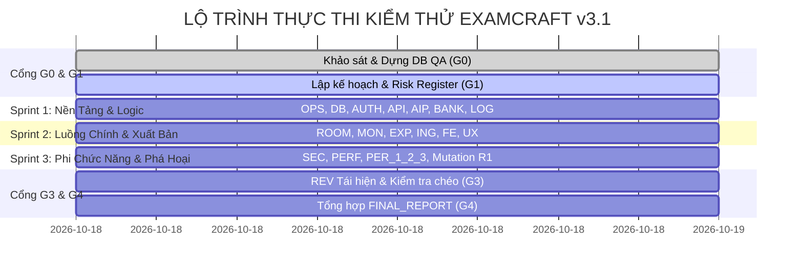

# KẾ HOẠCH KIỂM THỬ TỔNG THỂ (MASTER TEST PLAN) — EXAMCRAFT v3.1

- **Dự án**: ExamCraft v3.1
- **Test Director**: DIR (QA Lead)
- **Phương pháp tiếp cận**: Kết hợp Waterfall (5 Cổng Nghiệm Thu G0 $\rightarrow$ G4) + Agile (3 Sprints Thực Thi) + Risk-Based Testing.
- **Tiêu chuẩn chất lượng**: 100% kết luận kiểm thử phải đi kèm bằng chứng thực nghiệm (log lệnh, mã phản hồi HTTP, truy vấn SQL, ảnh chụp hoặc file:dòng). Không chấp nhận giả định hay suy đoán.

---

## 1. MỤC TIÊU VÀ PHẠM VI KIỂM THỬ

### 1.1 Mục Tiêu
1. Xác minh tính toàn vẹn và mức độ sẵn sàng thực tế của ExamCraft v3.1 so với các tuyên bố trong tài liệu.
2. Phát hiện sớm các lỗi nghiêm trọng về: rò rỉ đề thi/đáp án, vượt quyền chéo giáo viên (IDOR), sai lệch điểm số, hỏng định dạng file Word, và lỗi crash hệ thống.
3. Kiểm tra khả năng triển khai độc lập trên môi trường máy chủ cục bộ (Local Docker) và nền tảng điện toán đám mây (Vercel Serverless + Neon PostgreSQL).
4. Cung cấp báo cáo khách quan, minh bạch với khuyến nghị rõ ràng: **Go / Conditional-Go / No-Go**.

### 1.2 Phạm Vi Được Kiểm Thử
- **Toàn bộ 37 API Endpoints** và **11 Trang Giao Diện** của ứng dụng.
- **Toàn bộ 17 Models** và **14 Enums** trong cơ sở dữ liệu quan hệ PostgreSQL qua Prisma ORM.
- **Các thuật toán cốt lõi**: Phân phối và hoán vị mã đề (Fisher-Yates), chuẩn hóa đáp án ngắn, tính điểm lũy tiến Đúng/Sai Phần II theo barem Bộ GD&ĐT, điều phối xoay tua 7 Gemini API Keys.
- **Công cụ chuyển đổi tài liệu**: Sinh file Microsoft Word `.docx` với công thức toán học OMML native và cơ chế ngắt dòng/ngắt trang A4.
- **An toàn bảo mật & Riêng tư**: Xác thực phiên Session, chống tấn công dò mật khẩu (Brute-force lockout), chống XSS qua KaTeX/Markdown, chống CSV Formula Injection, và bảo vệ dữ liệu học sinh.

### 1.3 Phạm Vi Loại Trừ
- Kiểm thử xâm nhập mạng chuyên sâu ở tầng hạ tầng vật lý của nhà cung cấp dịch vụ máy chủ đám mây.
- Đánh giá khả năng tương thích trên các phiên bản trình duyệt Internet Explorer cũ (chỉ hỗ trợ Chrome, Firefox, Edge, Safari hiện đại).

---

## 2. NGUYÊN TẮC CÔ LẬP VÀ MÔI TRƯỜNG KIỂM THỬ

1. **Cô lập CSDL 100%**:
   - Máy chủ phát triển chạy trên cổng `5436` (database: `examcraft`).
   - Mọi hoạt động kiểm thử chỉ được phép chạy trên CSDL QA riêng biệt tại cổng `5437` (database: `examcraft_qa`, container: `examcraft_postgres_qa`).
   - Tuyệt đối không can thiệp vào volume `pgdata` hoặc thư mục `backups/` của môi trường chính.
2. **Nguyên tắc "Test-Only"**:
   - Không sửa đổi mã nguồn trong `src/`, `prisma/`, `scripts/`, `docs/`.
   - Toàn bộ kịch bản kiểm thử, fixtures, mocks, mutants và báo cáo chỉ được lưu trong `qa/` và `tests_e2e/`.
3. **Quản lý ngân sách gọi AI thật**:
   - Tổng số lượt gọi API Google Gemini thật trong toàn bộ đợt kiểm thử không vượt quá **30 requests**.
   - Mọi trường hợp thử nghiệm biên, kiểm tra mã lỗi (429, 503, timeout, sai schema) bắt buộc sử dụng bộ giả lập Mock (`qa/mocks/`). Mọi lần gọi thật phải ghi nhật ký vào `qa/ai_call_ledger.md`.

---

## 3. CƠ CẤU ĐỘI NGŨ & MA TRẬN TRÁCH NHIỆM (RACI MATRIX)

| Mã Vai | Tên Vai Trò | Trách Nhiệm Chính | RACI |
|---|---|---|---|
| **DIR** | Test Director | Chỉ huy chung, điều phối cổng nghiệm thu, ký duyệt báo cáo cuối cùng | **A** (Accountable) |
| **REC** | Recon & Doc-Auditor | Đối chiếu tuyên bố tài liệu với thực tế, truy vết mã nguồn | **R** (Responsible) |
| **OPS** | Ops & DevOps | Kiểm thử Docker, build, script backup/restore, tính sẵn sàng serverless | **R** |
| **DB** | Database Integrity | Kiểm tra schema, khóa ngoại, quan hệ cascade, snapshot bất biến | **R** |
| **AUTH** | Auth & Access Control | Đăng nhập, session, phân quyền Admin vs Teacher, lỗ hổng IDOR | **R** |
| **API** | Backend Contract | Kiểm thử hợp đồng 37 API routes, validation, mã trạng thái HTTP | **R** |
| **AIP** | AI Pipeline | Kiểm thử điều phối 7 keys, cooldown, rate-limit, prompt injection | **R** |
| **BANK** | Question Bank | Kiểm thử CRUD câu hỏi, revisions, diff & rollback, fork dùng chung | **R** |
| **LOG** | Business Logic | Kiểm thử thuật toán chấm điểm, barem lũy tiến, trộn đề, chuẩn hóa số | **R** |
| **ROOM** | Student Room | Kiểm thử phòng thi `/a/*`, cổng lớp `/c/*`, server timer, auto-save | **R** |
| **MON** | Teacher Monitoring | Kiểm thử màn hình giám sát realtime, chấm tay tự luận, xuất CSV | **R** |
| **EXP** | Export & Rendering | Kiểm thử xuất file Word .docx, 50+ công thức OMML, phân trang in A4 | **R** |
| **ING** | Ingestion & Parser | Kiểm thử nhập đề từ Word, ảnh OCR, text/LaTeX, import từ bản cũ | **R** |
| **FE/UX** | Frontend & UX | Kiểm thử giao diện người dùng, a11y, trải nghiệm học sinh điện thoại | **R** |
| **SEC** | Security & Privacy | Rà soát XSS, rò rỉ đáp án qua SSR, brute-force lockout, an toàn dữ liệu | **R** |
| **PERF** | Performance Testing | Thử tải 100 học sinh ảo nộp bài đồng thời, kiểm tra race condition | **R** |
| **PER** | Persona Explorers | Kiểm thử khám phá theo 3 nhân vật (Cô Lan, Em Minh, Kẻ phá hoại) | **R** |
| **REV** | Independent Reviewer | Tái hiện độc lập các lỗi Critical/High, kiểm tra chéo 20% ca test PASS | **V** (Verifier) |

---

## 4. LỘ TRÌNH 3 SPRINTS THỰC THI (GIAI ĐOẠN G2)

- **Sprint 1 — Nền Tảng & Nghiệp Vụ Cốt Lõi**:
  - Tập trung: Hạ tầng OPS, CSDL DB, Xác thực AUTH, Hợp đồng API, Điều phối AIP, Ngân hàng BANK, Logic chấm điểm LOG.
- **Sprint 2 — Luồng Người Dùng & Xuất Bản**:
  - Tập trung: Phòng thi học sinh ROOM, Giám sát giáo viên MON, Xuất Word/A4 EXP, Trình bóc tách ING, Giao diện FE/UX.
- **Sprint 3 — Bảo Mật, Hiệu Năng & Thăm Dò Khám Phá**:
  - Tập trung: An ninh mạng SEC, Thử tải 100 người dùng PERF, Kiểm thử theo Persona PER (1, 2, 3), Thử nghiệm Mutation R1.
- **Giai đoạn G3 — Đánh Giá Chéo & Hồi Quy**:
  - REV tái hiện độc lập 100% bug Critical và High; kiểm tra ngẫu nhiên ≥ 20% ca test PASS.
- **Giai đoạn G4 — Báo Cáo Tổng Hợp & Đánh Giá Go/No-Go**:
  - DIR xuất bản `qa/FINAL_REPORT.md`.
